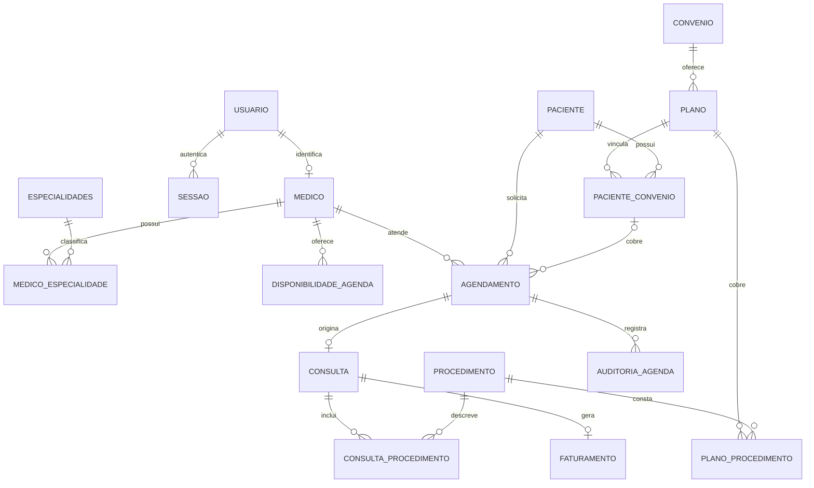
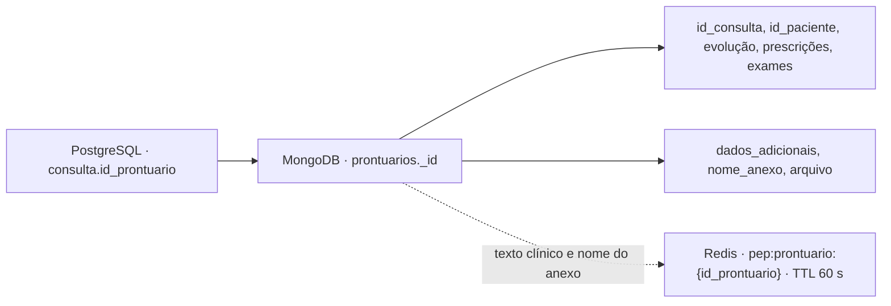

# Arquitetura e modelagem do PEP

O frontend React apresenta as telas. A API FastAPI concentra as regras de negócio e o acesso aos bancos. O Docker Compose inicia os cinco serviços do MVP.

| Tecnologia | Responsabilidade |
| --- | --- |
| PostgreSQL | Cadastros, agenda, procedimentos, sessões e faturamento. Chaves estrangeiras e transações protegem os vínculos e as operações administrativas. |
| MongoDB | Um documento por consulta. Prescrição, exames, campos específicos da especialidade e anexo são opcionais e ficam junto da evolução clínica. |
| Redis | Cópia temporária do texto clínico usado na leitura do prontuário pelo histórico. O texto fica em cache por 60 segundos. O anexo é servido pelo MongoDB. |

## Modelo relacional

O diagrama apresenta as entidades do atendimento e as suas relações. Os detalhes de colunas e restrições estão no [schema](../backend/sql/schema.sql) e nas [migrações](../backend/sql/migrations).



Cadastros e relações de muitos para muitos ficam em tabelas próprias, como médico e especialidade ou plano e procedimento. O telefone da conta pertence a `usuario`. A migração `008_telefone_usuario` recupera o telefone antigo de `medico` quando o usuário ainda não tem telefone e prioriza o valor da conta quando ambos existem.

O agendamento é a fonte da data e da hora reservadas. A consulta guarda a referência histórica copiada na abertura do atendimento, e o faturamento usa a data da consulta. `consulta.id_agendamento` é uma chave alternativa única. O valor em `consulta_procedimento` é o preço registrado na inclusão, de modo que mudanças no catálogo preservem o cálculo das consultas anteriores.

A API lê a visão `agenda_clinica`. A *trigger* `auditar_agenda` registra a criação e as alterações de situação do agendamento. Um índice único parcial impede dois agendamentos ativos para o mesmo médico, data e horário. A reserva também é feita por atualização condicional dentro da mesma transação que cria o agendamento. A *procedure* `fechar_faturamento` consolida procedimentos em uma cobrança por consulta, com bloqueio das consultas elegíveis e proteção contra duplicidade.

## Coleção de prontuários



Exemplo de documento. O MongoDB armazena `arquivo` como conteúdo binário quando há anexo.

```json
{
  "_id": "71577380-2b3d-4463-b070-cd7415538105",
  "id_consulta": "71577380-2b3d-4463-b070-cd7415538105",
  "id_paciente": "a7e71c28-f395-4c2c-8a8e-784b3aa559cb",
  "evolucao": "Atendimento fictício para demonstração.",
  "prescricoes": null,
  "exames": "Solicitado exame de exemplo.",
  "dados_adicionais": {"Escala de dor": "2"},
  "nome_anexo": "exame.txt"
}
```

O comando `python -m app.manage init-mongo` cria a coleção explicitamente na inicialização da API. O MongoDB cria seu índice único de `_id` junto com a coleção. O comando aceita uma coleção já existente e preserva seus documentos. A rotina [prontuario.py](../backend/app/prontuario.py) usa `replace_one(..., upsert=True)` na gravação e `find_one(...)` na leitura. O Redis usa `GET` e `SET` com expiração.

## Consistência e permissões

1. A API verifica no PostgreSQL que o usuário é o médico responsável e bloqueia a consulta durante a gravação.
2. A API grava o documento no MongoDB usando o ID da consulta como chave. Só depois atualiza a referência no PostgreSQL.
3. Uma falha na escrita do MongoDB retorna erro e reverte a transação SQL. Se o SQL falhar depois da escrita no MongoDB, o documento permanece invisível pela API até o salvamento ser repetido. A repetição usa a mesma chave.
4. A conclusão e o faturamento exigem a referência gravada. O registro fica disponível para leitura após o envio. A edição posterior e o versionamento ficam fora do MVP.
5. A leitura aplica *cache-aside*. Após conferir a permissão e o vínculo no SQL, a API tenta o Redis e usa o MongoDB quando necessário. O registro publicado é imutável e a chave expira em 60 segundos. Se o Redis ficar indisponível, a leitura segue pelo MongoDB.

A equipe administrativa vê o histórico operacional. A leitura do conteúdo clínico e o download exigem vínculo do médico com o paciente por agendamento ativo ou realizado. A gravação é restrita ao médico da consulta. Para o MVP local, use exclusivamente dados fictícios. A validação de CPF verifica o formato e a unicidade local. A consulta da situação cadastral na Receita e a medição de disponibilidade por um período de operação exigem integrações e condições que excedem esta demonstração.
